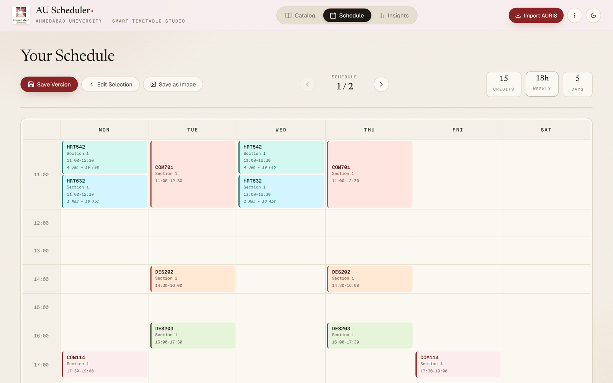
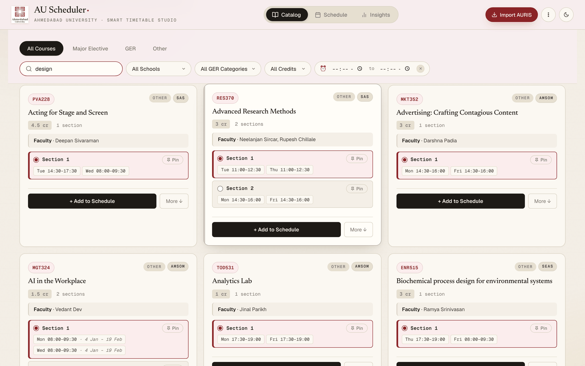
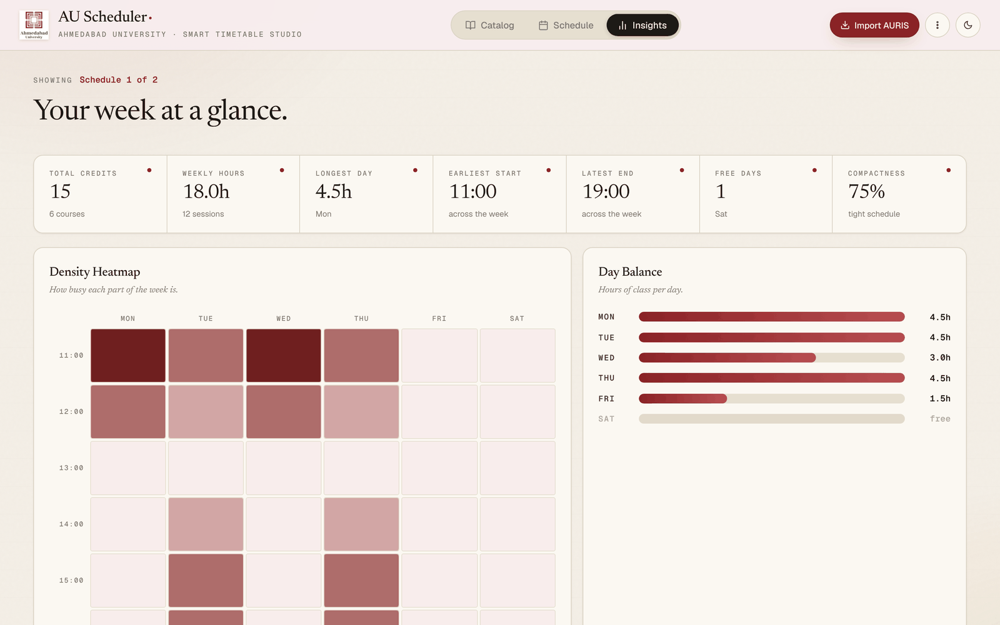
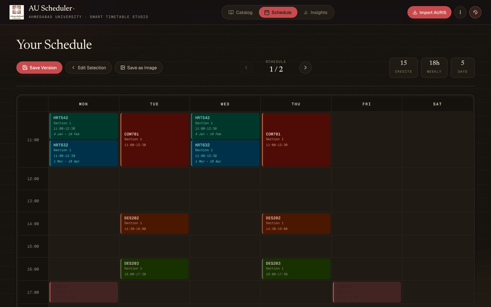
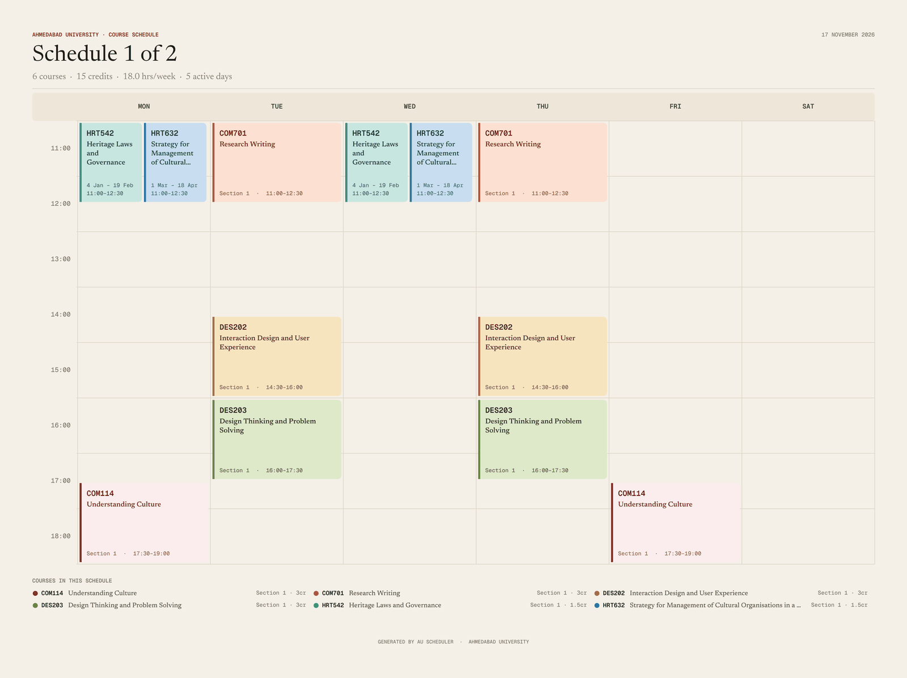

<div align="center">


# AU Scheduler

**Build a clash-free timetable from the Ahmedabad University course directory in seconds.**

Import the AURIS Excel export, pick your courses, and let the scheduler find every
combination of sections that fits — ranked so the best week comes first.

[**🚀 Open the live app**](https://course-scheduler-eight.vercel.app/) &nbsp;·&nbsp;
[How to use](#-how-to-use) &nbsp;·&nbsp;
[Run locally](#-run-it-locally) &nbsp;·&nbsp;
[How it works](#-how-it-works)




</div>

---

## ✨ Features

| | |
|---|---|
| 📥 **One-click AURIS import** | Upload the Course Directory export (`.xlsx`, `.xls` or `.csv`). Courses, sections, faculty, credits, schools and **class timings** are read automatically — old and new AURIS formats both work. |
| ⚡ **Clash-free schedule generator** | Finds every valid combination of sections (up to 200) and ranks them: fewer days on campus, later starts, smaller gaps and an even spread come first. |
| 🗓️ **Half-term aware** | Courses that run only part of the term (e.g. *4 Jan – 19 Feb*) keep their dates, so two half-term courses in the same weekly slot are **not** counted as a clash. |
| 📌 **Pin sections** | Lock the section you want and the generator builds everything else around it. |
| 🔴 **Clash map** | If nothing fits, see exactly which classes overlap and where. |
| 🔎 **Smart catalog** | Filter by type (Major Elective / GER / Other), school, GER category, credits and time window, or search by name, code or faculty. |
| 🎯 **Credit tracker** | Set a semester credit target; the tracker splits your load into major electives, GERs and free electives. |
| 💾 **Save & compare** | Save versions of your timetable and compare any two side-by-side with the differences highlighted. |
| 📊 **Insights** | Weekly hours, longest day, earliest start, free days, compactness, a density heatmap and a per-day breakdown. |
| 🖼️ **Export as image** | Download a high-resolution PNG of your week to share or set as a wallpaper. |
| 🤝 **Share with friends** | Copy a short code of your picks; a friend pastes it to load the same courses and pinned sections. |
| 🌗 **Light & dark themes · 📱 mobile friendly** | A clean, responsive design with a bottom tab bar on phones. |

<table>
  <tr>
    <td width="50%"></td>
    <td width="50%"></td>
  </tr>
  <tr>
    <td align="center"><sub>Catalog — every section with its timings (and dates for half-term courses)</sub></td>
    <td align="center"><sub>Insights — your week at a glance</sub></td>
  </tr>
  <tr>
    <td width="50%"></td>
    <td width="50%"></td>
  </tr>
  <tr>
    <td align="center"><sub>Dark mode</sub></td>
    <td align="center"><sub>“Save as Image” export</sub></td>
  </tr>
</table>

---

## 🧭 How to use

1. **Export from AURIS**
   Log in to AURIS → **Course Directory** → choose the semester (e.g. *Winter 2027*) → click **Excel** (or **CSV**).
   *Older AURIS versions export one file per school — just import each one.*
2. **Import it here**
   Open the app → **Import AURIS** → choose **Auto-Detect** (or a school for files that have no *School* column) → select the file.
   You'll see a summary such as `✅ Imported 328 courses · 450/477 sections timed`.
3. **Pick your courses** in the **Catalog** tab (up to 10). Use the radio buttons to prefer a section, or **Pin** it to force it.
4. **Generate Schedules** → browse the results with the arrows (or ← / → keys).
5. **Save Version**, **Compare**, check **Insights**, or **Save as Image**.

### ⌨️ Keyboard shortcuts

| Key | Action | | Key | Action |
|:---:|---|---|:---:|---|
| <kbd>1</kbd> | Catalog tab | | <kbd>/</kbd> | Focus search |
| <kbd>2</kbd> | Schedule tab | | <kbd>T</kbd> | Toggle dark / light |
| <kbd>3</kbd> | Insights tab | | <kbd>←</kbd> <kbd>→</kbd> | Previous / next schedule |
| | | | <kbd>Esc</kbd> | Close any dialog |

---

## 📄 Supported AURIS formats

The importer looks for the sheet that contains a **Course Code** header (title rows above it are fine) and reads the timings from the **Schedule** column. Every timing style AURIS has used so far is understood:

| Export | Example *Schedule* cell |
|---|---|
| **AURIS2** (current) | `Section 1: Mon, Wed 08:00-09:30`<br>`Section 2: Tue 16:00-17:30 (4 Jan – 19 Feb); Fri 11:00-12:30` |
| **AURIS** (older) | `Section 1 Mon [08:00 to 09:30] Wed [08:00 to 09:30]` |
| “Section Timings” sheet | one row per section with `Mon` … `Sat` columns, e.g. `10:00-11:00, 17:00-19:00` |

It also handles full day names (`Monday`), 12-hour times (`2:30 PM - 4:00 PM`), and dates written as `4 Jan`, `Jan 4`, `04/01/2027` or `2027-01-04`.

Other columns that are picked up when present: **Course Name**, **School**, **Credits**, **Faculty**, **GER Categories** / **GER Category**, **Course Description**.
Sections listed as `TBA` are imported as *Timings TBA*. If some timings can't be read, the app tells you which courses were affected instead of silently dropping them.

---

## 💻 Run it locally

There is **no build step and nothing to install** — it's plain HTML, CSS and JavaScript. Any static file server works; with Python:

```bash
git clone https://github.com/TanmayKanani/AU_SCHEDULER.git
```

```bash
cd AU_SCHEDULER
```

```bash
python3 -m http.server 8000
```

Then open <http://localhost:8000>.

> The page loads [SheetJS](https://sheetjs.com/) (Excel reader) from cdnjs and fonts from Google Fonts, so you need an internet connection the first time.

### 🚀 Deploy

The live site is a static deployment on **Vercel** — no framework preset, no build command, output directory = project root.
Either connect this GitHub repository in the Vercel dashboard (every push to `main` redeploys), or from the project folder run:

```bash
vercel --prod
```

---

## 🗂️ Project structure

```
AU_SCHEDULER/
├── index.html          # Page layout: header, Catalog / Schedule / Insights tabs, dialogs
├── styles.css          # Design system (light + dark themes, responsive layout)
├── courses.js          # Course store + AURIS import (Excel/CSV/JSON) and the timing parser
├── scheduler.js        # Schedule engine: clash detection, backtracking search, scoring
├── app.js              # UI logic: catalog, filters, timetable, insights, save/compare, export
├── auris_scraper.js    # Optional console script that scrapes the AURIS course pages to JSON
├── au_logo.png         # Ahmedabad University logo
└── docs/screenshots/   # Images used in this README
```

---

## ⚙️ How it works

**1. Import → `courses.js`**
SheetJS reads the workbook in the browser. `readCourseRowsFromWorkbook()` finds the right sheet and header row, and `parseScheduleText()` turns each *Schedule* cell into sections and time slots:

```js
{ day: 'Tue', startTime: '16:00', endTime: '17:30', dates: [{ from: '01-04', to: '02-19' }] }
```

A slot without `dates` runs for the whole term.

**2. Generate → `scheduler.js`**
A backtracking search tries one section per course and drops any branch where two slots overlap — *same day, overlapping time **and** overlapping dates*. Pinned sections are the only option for their course; your preferred section is tried first.

**3. Rank**
Each valid schedule gets a score:

| Rule | Points |
|---|---|
| Every day with no classes | **+10** |
| Day starts at/after 9:00 · 10:00 | **+3** · **+5** more |
| Gap between classes ≤ 30 min · ≤ 60 min · longer | **+5** · **+2** · **−2** |
| Uneven number of classes per day | **−3 × variance** |

**4. Your data stays with you**
Everything runs in your browser. Imported files are never uploaded anywhere; saved schedules and your theme choice live in your browser's local storage.

---

## 🛠️ Troubleshooting

| Problem | Fix |
|---|---|
| “No courses found — is this the AURIS Course Directory export?” | Make sure the file has a **Course Code** column. Export the Course Directory, not another report. |
| “⚠️ Imported … but timings for N could not be read (…)” | AURIS changed its format again. The message (and the browser console) lists the affected course codes — open an issue with one example *Schedule* cell. |
| A course shows **Timings TBA** | AURIS hasn't published timings for that section yet. |
| Changes don't show up after an update | Hard-refresh the page (<kbd>Ctrl</kbd>/<kbd>Cmd</kbd> + <kbd>Shift</kbd> + <kbd>R</kbd>). |

---

## 🤝 Contributing

Issues and pull requests are welcome! To test a change, run the site locally (see above), import a recent AURIS export and check the Catalog, Schedule and Insights tabs in both themes.

---

<div align="center">

Made for Ahmedabad University students by [**@TanmayKanani**](https://github.com/TanmayKanani)

<sub>An independent student project — not an official Ahmedabad University service. AURIS data belongs to the university.</sub>

</div>
